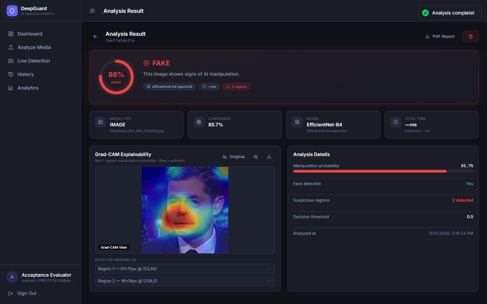
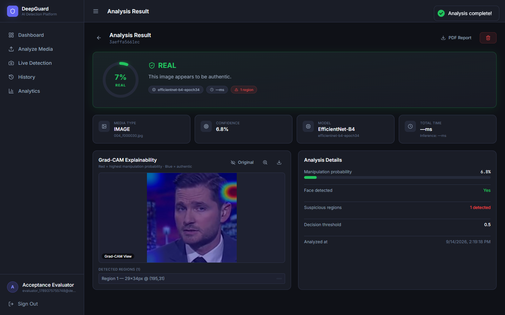
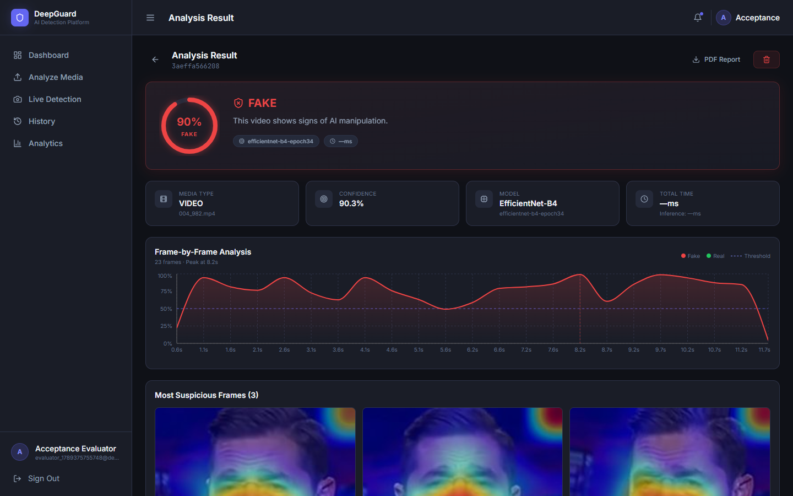
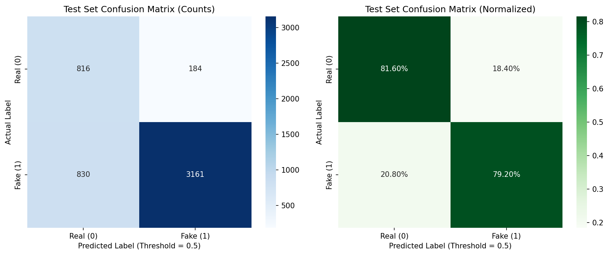

# 🛡️ DeepGuard — AI-Powered DeepFake Detection Platform

[](LICENSE)
[](client/)
[](server/)
[](ai-service/)
[](ai-service/)

> Academic research and demonstration deepfake detection platform utilizing a fine-tuned **EfficientNet-B4** convolutional neural network with **Grad-CAM visual explainability**, intelligent temporal frame aggregation, and automated analysis report generation. Built with a React SPA frontend, an Express/Node.js orchestration backend, MongoDB persistence, and a Python FastAPI AI microservice.

---

## 📌 Problem Statement & Objectives

Synthetic media and generative AI manipulation present significant verification challenges, enabling realistic face-swaps, identity spoofing, and digital misinformation.

**DeepGuard** was designed as an applied research platform to investigate multi-stage deepfake detection with four core objectives:
1. **Accurate Detection**: Fine-tuned classification on academic benchmarks (FaceForensics++ C23) targeting facial blending and boundary artifacts.
2. **Transparent Explainability**: Moving beyond black-box classification by generating Grad-CAM heatmaps to visually highlight facial regions that most strongly influenced the neural network's prediction, rather than claiming to prove ground-truth pixel-level manipulation.
3. **Multi-Modal Verification**: Primary visual pipeline for standalone images and multi-frame video with strict human face presence verification; prototype extensions for audio and smart contract verification.
4. **Structured Reporting**: Exporting structured PDF analysis summaries containing metadata, confidence metrics, and heatmap snapshots for documentation and review (non-cryptographically signed).

---

## 🏗️ System Architecture

```text
React Frontend (Vite SPA) ── [Port 3000]
       │
       │ REST API / JWT Authentication
       ▼
Node.js / Express Backend ── [Port 5000] ── MongoDB Database [Port 27017]
       │                                     (Audit Logs, Analysis History,
       │ Internal Service API /               Users & Refresh Tokens)
       │ Magic-Byte Validation
       ▼
FastAPI AI Microservice ── [Port 8000] (Stateless Inference)
       │
       ├── PyTorch 2.3 + NVIDIA CUDA (Native GPU)
       ├── MediaPipe Face Detection & Cropping (224×224)
       ├── EfficientNet-B4 Classification Head
       └── Grad-CAM Explainability Heatmaps
```

---

## 📸 Screenshots & Forensic Visualizations

### Detection Results & Forensic Heatmaps
| Fake Image Detection (Grad-CAM Heatmap) | Authentic Image Verification |
| :---: | :---: |
|  |  |

| Video Temporal Analysis & Timeline | Model Evaluation & Confusion Matrix |
| :---: | :---: |
|  |  |

---

## 📊 Validated Model Performance (Frame-Level Benchmark)

The deepfake classifier utilizes **EfficientNet-B4** with a custom multi-layer perceptron (MLP) classification head fine-tuned on the **FaceForensics++ C23** benchmark. The metrics below report **single-frame classification performance on isolated test face crops** (4,991 evaluated test frames), **not** aggregated multi-frame video classification performance:

| Metric | Value | Evaluation Unit & Dataset |
| :--- | :--- | :--- |
| **ROC-AUC** | **0.8853** | Single-frame crops (FaceForensics++ C23 test split) |
| **PR-AUC** | **0.9686** | Single-frame crops (FaceForensics++ C23 test split) |
| **Accuracy** | **79.68%** | Single-frame crops (FaceForensics++ C23 test split) |
| **Fake Precision** | **94.50%** | Single-frame crops (FaceForensics++ C23 test split) |
| **Fake Recall (Sensitivity)** | **79.20%** | Single-frame crops (FaceForensics++ C23 test split) |
| **Specificity** | **81.60%** | Single-frame crops (FaceForensics++ C23 test split) |
| **F1 Score (Fake)** | **86.18%** | Single-frame crops (FaceForensics++ C23 test split) |
| **Inference Latency** | **~82ms / frame** | NVIDIA GeForce RTX 3050 Laptop GPU / CUDA |

*Note on Preprocessing: Face crops are extracted via MediaPipe FaceDetection (min detection confidence: 0.7, model selection: 1, face margin: 0.4), resized to 224×224 with cv2.INTER_LANCZOS4 interpolation, and normalized with ImageNet mean and standard deviation.*

*Note on Video Frame-Sampling Optimization: DeepGuard utilizes a forward sequential decoding strategy (`decode_strategy="sequential"`) that eliminates redundant GOP keyframe seeks during scene boundary detection and frame extraction. In comparative benchmarks against the legacy random-access seek baseline (`decode_strategy="legacy"`), this achieved an $\approx 8.1\times$ speedup specifically in video frame sampling and decoding (reducing sampling latency from ~3.64s to ~0.45s on benchmark video sequences). Total end-to-end video analysis latency improved by ~3.5×–4.5×, while single-frame GPU inference latency remains constant at ~82ms per frame on an NVIDIA GeForce RTX 3050 Laptop GPU.*

### ⚠️ Known Video Limitations & Responsible AI Notice
- **Compression Artifacts & False Positives**: H.264/video compression (such as FaceForensics++ C23 compression) introduces block boundaries and high-frequency quantization artifacts that the convolutional feature extractor may associate with manipulation patterns. Consequently, certain authentic compressed sequences can receive elevated suspicion scores (for example, authentic test video `003.mp4` received an aggregation score of ~0.539, crossing the default decision threshold $\theta = 0.50$).
- **Frame-Level vs. Video-Level Performance**: High single-frame precision on isolated crops does not prevent temporal false alarms when authentic frames exhibit atypical lighting, motion blur, or compression noise.
- **Human Review Recommended**: DeepGuard predictions represent automated statistical anomaly indicators. They do not constitute conclusive forensic certainty or legal proof. Independent human expert evaluation is strongly recommended before making consequential decisions.

---

## 🔍 Feature Status

| Feature | Status | Description |
| :--- | :--- | :--- |
| **Image Detection** | ✅ Operational | Upload JPEG, PNG, or WebP to detect manipulated facial features with Grad-CAM overlays. |
| **Video Detection** | ✅ Operational | Adaptive scene-aware frame sampling (configurable `min_frames=10`, `max_frames=60`, `target_fps=2.0`; e.g., 31 frames on ~15s test video), ~8.1× frame-sampling speedup over legacy GOP seek decoding, batch GPU inference, temporal aggregation, and keyframe timeline. |
| **Live Webcam** | ✅ Operational | Browser canvas capture with rolling confidence evaluation and live feedback. |
| **Grad-CAM Heatmaps** | ✅ Operational | Visualizes convolutional gradient activations that most heavily influenced model prediction (interpretable saliency, not pixel-level manipulation proof). |
| **No-Face Handling** | ✅ Operational | Strictly verifies human face presence; cleanly returns `UNCERTAIN` when no face is found. |
| **PDF Forensic Reports** | ✅ Operational | Generates structured PDF analysis summaries with execution timings, confidence metrics, and heatmap snapshots (non-cryptographically signed). |
| **Audio Detection** | 🔬 Prototype | Experimental endpoint implemented at the API/UI integration layer. Production inference is inactive pending specialized AudioDeepFakeCNN checkpoint training. |
| **Blockchain Verification** | 🔬 Prototype | Experimental Solidity `MediaVerification` smart contract prototype with local tests; not deployed to live public networks. |

---

## 📁 Repository Structure

```text
deepguard-platform/
├── .github/workflows/         # Continuous integration pipelines
├── ai-service/                # Python FastAPI AI microservice
│   ├── app/core/              # Service configuration & GPU allocator
│   ├── models/                # EfficientNet loader & architecture definitions
│   ├── preprocessing/         # MediaPipe face extraction & frame sampling
│   ├── services/              # Image, video, audio & explainability engines
│   ├── tests/                 # pytest test suite
│   ├── training/              # Training pipelines & dataset loaders
│   ├── requirements.txt       # Python dependencies
│   └── main.py                # FastAPI entry point
├── blockchain/                # Solidity MediaVerification prototype & unit tests
├── browser-extension/         # DeepGuard Chrome extension prototype
├── client/                    # React SPA (Vite + Tailwind CSS)
│   ├── src/components/        # UI components (HeatmapViewer, ConfidenceGauge, etc.)
│   ├── src/pages/             # App pages (Dashboard, Upload, History, Analytics)
│   └── src/services/          # Frontend API integration & Auth services
├── docs/                      # Screenshots, metrics, and forensic evaluations
├── scripts/                   # Native-first PowerShell management & launch scripts
├── server/                    # Node.js / Express backend API
│   ├── src/controllers/       # Auth, detection, history, report controllers
│   ├── src/middleware/        # JWT auth, rate limiting, file validation
│   ├── src/models/            # Mongoose schemas (DetectionResult, User, AuditLog)
│   ├── src/routes/            # Express REST route definitions
│   ├── src/services/          # Internal AI proxy, PDFKit generator
│   └── tests/                 # Jest integration tests
├── docker-compose.yml         # Container orchestration (Development profile)
├── docker-compose.prod.yml    # Container orchestration (Production profile)
├── CONTRIBUTING.md            # Guidelines for open-source contributions
└── LICENSE                    # MIT License
```

---

## 🚀 Native-First Setup & Quick Start

DeepGuard is built **Native-First**. It executes directly on the host operating system with native NVIDIA CUDA GPU acceleration, and **does not require Docker, Docker Desktop, Docker Compose, WSL2, or NVIDIA Container Toolkit**.

### Host Prerequisites
- **Node.js**: v18+ (Node 20/24 supported)
- **Python**: 3.11 with CUDA-enabled PyTorch (CUDA 12.1 recommended)
- **MongoDB**: Local MongoDB instance listening on `mongodb://127.0.0.1:27017/deepguard`
- **GPU**: NVIDIA GPU with CUDA driver (verified on NVIDIA GeForce RTX 3050 Laptop GPU)

### Model Checkpoint & Benchmark Datasets
- **Production Checkpoint**: The primary model checkpoint (`models/efficientnet_b4_deepfake.pt`, SHA-256: `8530dddce89f2228d8b75ef1eb76996517a39f696b8d248003acb02d53f5210f`, 75,191,270 bytes) must be placed in the `models/` directory prior to running the AI service.
- **Experimental & Research Artifacts**: Intermediate checkpoints (`models/experiments/`) and research notes (`docs/research/`) are intentionally excluded from Git tracking (`.gitignore`).
- **Benchmark Datasets**: Training and benchmark datasets (e.g. FaceForensics++) are not distributed in this repository due to academic licensing and storage constraints. Authorized researchers must obtain datasets directly from their respective academic custodians.

### 1. Pre-Flight Environment Audit
Verify your native host dependencies with the built-in validator script:
```powershell
powershell -ExecutionPolicy Bypass -File scripts/check_native_env.ps1
```

### 2. Configure Environment Variables
Copy the `.env.example` templates in each component directory:
```powershell
# Server configuration
Copy-Item server/.env.example server/.env

# AI Service configuration
Copy-Item ai-service/.env.example ai-service/.env

# Client configuration
Copy-Item client/.env.example client/.env
```

### 3. 1-Click Native Launch
Start the entire platform (MongoDB, AI Microservice, Node Backend, and React Frontend) with a single command:
```powershell
powershell -ExecutionPolicy Bypass -File scripts/start_native.ps1
```

*(To stop all running services later, run `powershell -ExecutionPolicy Bypass -File scripts/start_native.ps1 -Stop`)*

---

### Manual Step-by-Step Launch

If you prefer to run services in individual terminals:

#### Step 1: AI Microservice (FastAPI + PyTorch CUDA)
```powershell
cd ai-service
.\venv\Scripts\Activate.ps1
uvicorn main:app --host 127.0.0.1 --port 8000 --reload
```

#### Step 2: Backend Server (Node.js + Express)
```powershell
cd server
npm install
npm run dev
```

#### Step 3: Frontend Client (React + Vite)
```powershell
cd client
npm install
npm run dev
```

Visit `http://localhost:3000` to register an account and start analyzing media.

---

## 🐳 Optional Container Deployment (Docker Profile)

> [!NOTE]
> **Docker is optional.** The native host setup above is the official, default runtime for development, automated testing, demonstrations, and native CUDA GPU acceleration.

If containerized delivery is preferred:

- **Development Stack** (Mongo 7, Client dev hot-reload, Express backend, FastAPI):
  ```powershell
  docker compose up --build
  ```

- **Production Stack** (Nginx SPA, Node backend, GPU-enabled AI service, persistent volumes):
  ```powershell
  docker compose -f docker-compose.prod.yml up --build
  ```

---

## 📡 Key API Endpoints

### Authentication (`/api/auth`)
| Method | Endpoint | Description | Auth Required |
| :--- | :--- | :--- | :--- |
| `POST` | `/api/auth/register` | Register a new user account | No |
| `POST` | `/api/auth/login` | Authenticate and obtain JWT tokens | No |
| `POST` | `/api/auth/refresh` | Exchange refresh token for new access token | No |
| `POST` | `/api/auth/logout` | Invalidate active session | Yes |
| `GET` | `/api/auth/me` | Fetch authenticated user profile | Yes |

### Detection & Analysis (`/api/detect`)
| Method | Endpoint | Description | Auth Required |
| :--- | :--- | :--- | :--- |
| `POST` | `/api/detect/image` | Upload image for face extraction & Grad-CAM analysis | Yes |
| `POST` | `/api/detect/video` | Upload video for frame sampling & temporal aggregation | Yes |
| `POST` | `/api/detect/audio` | Audio file inference endpoint (prototype) | Yes |
| `GET` | `/api/detect/result/:id` | Retrieve detection output by analysis ID | Yes |

### History & Reports (`/api/history`, `/api/reports`)
| Method | Endpoint | Description | Auth Required |
| :--- | :--- | :--- | :--- |
| `GET` | `/api/history` | Paginated list of previous scans for the user | Yes |
| `GET` | `/api/reports/:id/pdf` | Download analysis summary PDF report with metadata & heatmap | Yes |

---

## 🧪 Testing Instructions

DeepGuard includes test suites across backend orchestration and AI inference components:

### Backend Tests (Jest)
Runs API route tests, auth validation, and mock detection tests:
```bash
cd server
npm test
```

### AI Microservice Tests (pytest)
Runs preprocessing, face extraction, and FastAPI endpoint tests:
```bash
cd ai-service
pytest tests/
```

---

## 🔮 Future Enhancements

- [ ] **Full Audio Model Deployment**: Finalize checkpoint training for `AudioDeepFakeCNN` to enable production speech synthesis detection.
- [ ] **Multi-Face Scene Forensics**: Simultaneous bounding box and Grad-CAM generation for scenes with multiple subjects.
- [ ] **Decentralized Hash Registry**: Deploy the Polygon `MediaVerification` smart contract to a testnet with automated digest notarization.
- [ ] **Wasm / WebGPU Edge Inference**: Client-side face pre-screening to eliminate network transmission for non-face images.

---

## 👥 Author & License

- **Author**: Sri Snigdha
- **License**: Released under the [MIT License](LICENSE).
- **Contributions**: Please read [CONTRIBUTING.md](CONTRIBUTING.md) before opening a pull request.
